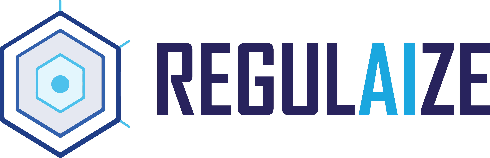

## Project Information

**RegulAIze** aims to achieve automated regulatory compliance within data spaces, drawing on synthetic data and compliance technologies. It simplifies regulatory compliance, facilitates reporting, safeguards data transactions and offers adaptive monitoring integrated into workflows. At its core is an AI-powered compliance certifier integrated into the European Data Spaces, supported by NLP.

## Website and Social Media

-   [Website](https://www.regulaize-horizon.eu/)
-   [LinkedIn](https://www.linkedin.com/company/regulaize-eu/)

